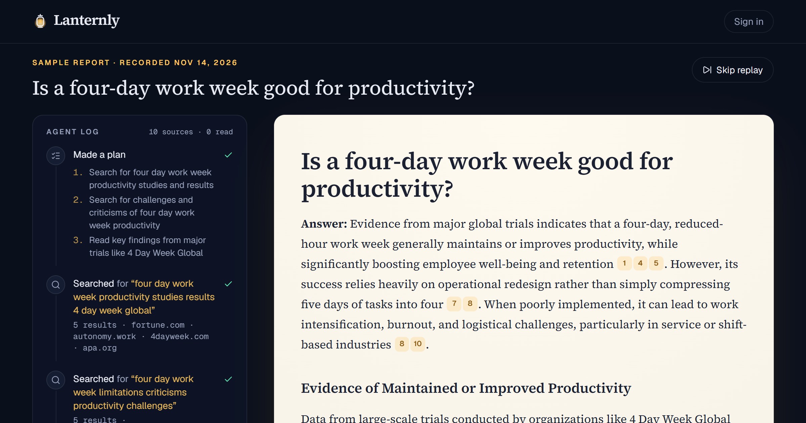
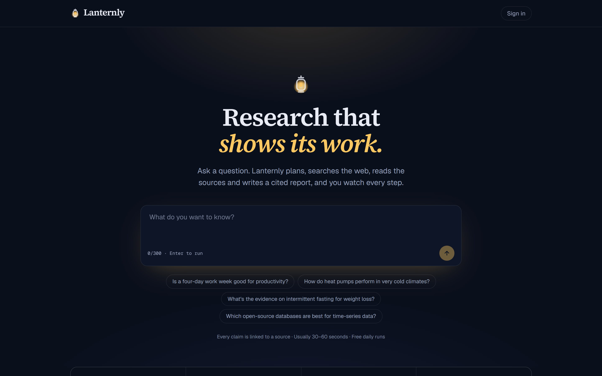
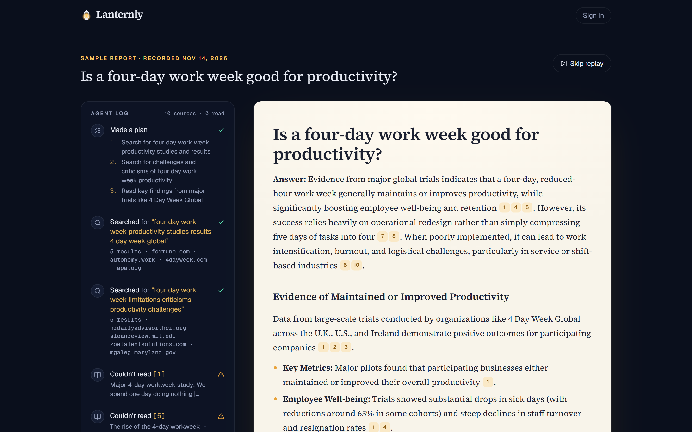
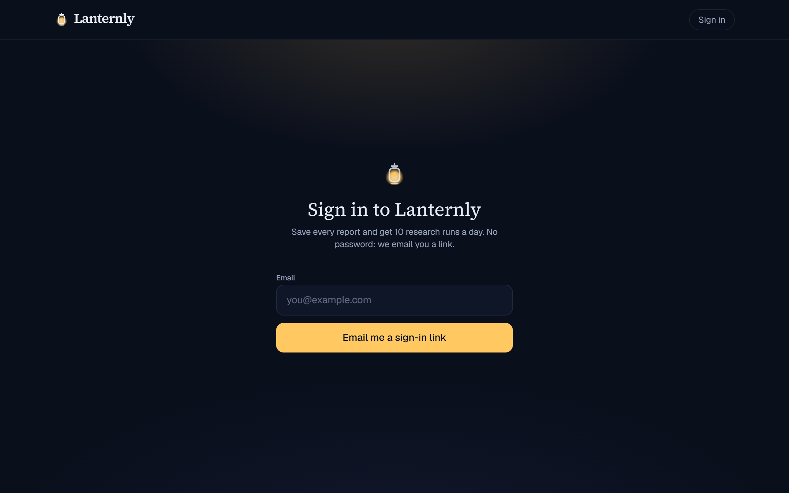
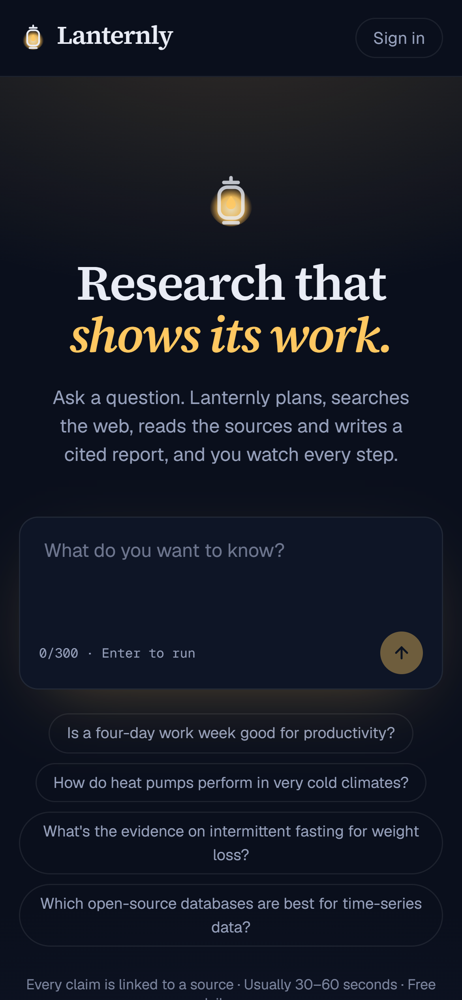
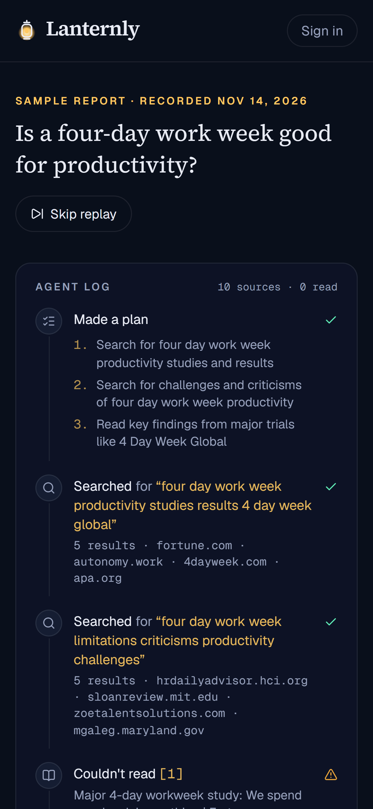
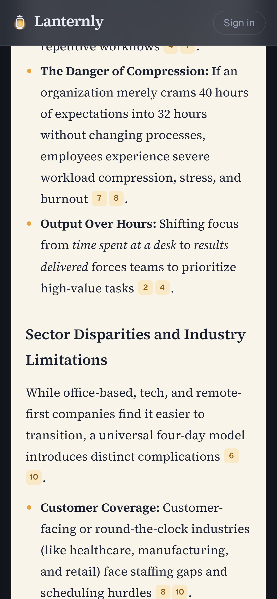

# Lanternly: AI research that shows its work

**Live site:** https://lanternly-research-agent.vercel.app

Ask a question and watch an AI agent work: it plans the research, runs web searches, reads the most promising pages, and writes a report where every claim links to its source. The agent log shows each step as it happens, so you can see exactly where an answer came from.

> Lanternly is a portfolio project. Reports come from a free AI model and can contain mistakes. Check important claims against the linked sources.



## Screenshots

| Home | Agent at work |
|---|---|
|  |  |

| Finished report | Sign in |
|---|---|
|  |  |

| Mobile home | Mobile, agent running | Mobile report |
|---|---|---|
|  |  |  |

Full-page captures are in [`docs/screenshots`](docs/screenshots), and the case study is in [`docs/case-study.md`](docs/case-study.md).

## How it works

```
question ──▶ plan ──▶ search × 2-4 ──▶ read × 2-4 ──▶ write cited report
                         │                  │
                   numbered sources   only sources search returned
```

1. **Plan:** the agent is forced to call a `plan` tool first, which shows its approach in the log.
2. **Search:** a `search` tool queries Tavily. Every result gets a source number, deduplicated by URL.
3. **Read:** a `read` tool fetches the full page through Jina Reader. It accepts only source numbers that search returned, so page content can't steer the agent into fetching arbitrary URLs. Blocked or paywalled pages are reported as failed reads.
4. **Write:** the final steps run with no tools, so the agent must write. The report cites sources as `[n]`, which the UI turns into numbered chips linking to the source.

The whole run streams to the browser with the Vercel AI SDK (`streamText` + `toUIMessageStream` + `useChat`). Each tool call becomes a typed message part, and the agent log is built from those parts.

## Features
- Live agent log: plan, searches (with result domains), pages read (with size), writing
- Report on "lantern-lit paper" with clickable numbered citations and a source list showing what was read in full, cited, or found but not used
- Shareable report links (`/r/…`), Markdown export, and Save as PDF (print styles)
- Email sign-in (magic link, no password) and a "My reports" library
- **Sample replays:** three real recorded runs play back step by step, so visitors can see the agent without using API quota
- Daily limits protect the free API quotas: 3 runs for visitors, 10 when signed in, 60 across everyone
- Handles messy model output, e.g. normalizes grouped citations like `[2, 7]` into separate links

## Security
- **The database is server-only.** Row-level security is on with no public policies, and all reads and writes go through the server with the secret key. The public key can't list or read anyone's reports.
- **Reports are private by default.** They're found only by their random ID (UUID), and only signed-in owners see their library.
- **Hashed IP addresses.** The rate limit stores IP addresses only as salted hashes.
- **Page content is treated as data.** The prompt marks search results and pages as untrusted, and the read tool can only open URLs that came from search.

## Lighthouse (production build)
| | Performance | Accessibility | Best Practices | SEO |
|---|---|---|---|---|
| Desktop | 100 | 100 | 100 | 100 |
| Mobile (simulated slow 4G + 4× CPU) | 77–82 | 100 | 100 | 100 |

## Stack ($0)
Next.js 16 (App Router, Proxy, Partial Prerendering) · TypeScript · Tailwind CSS v4 · Vercel AI SDK 7 · Google Gemini 3.5 Flash-Lite (free tier) · Tavily search (free tier) · Jina Reader · Supabase (Postgres + Auth) · Vercel Hobby

## Run locally
```bash
npm install
cp .env.example .env.local   # then fill in the keys
npm run dev
```

1. **Database tables:** run [`supabase/schema.sql`](supabase/schema.sql) in the Supabase SQL editor.
2. **Sign-in links:** in Supabase **Authentication → URL Configuration**, add `http://localhost:3000/**` and your deployed URL to the redirect URLs.
3. **Without the AI and search keys:** the app still runs and shows the sample replays.

To record new sample replays, run `RECORD_SAMPLES=1 npm run dev` and ask a question. The run is saved to `src/samples/data/`; register it in `src/samples/index.ts`.

## Project structure
```
src/
  app/
    api/research/route.ts   # the agent endpoint: limits, streaming, saving
    r/[id]/                 # shared report page
    sample/[slug]/          # sample replays
    history/ login/ auth/   # library and magic-link sign-in
  lib/
    agent/                  # tools (plan/search/read), prompt, Tavily + Jina
    derive.ts               # turns message parts into the timeline, sources, citations
    limits.ts               # daily run limits
    supabase/               # session + admin clients
  components/               # run view, timeline, report, replay
  samples/                  # recorded runs
  proxy.ts                  # keeps the sign-in session fresh
supabase/schema.sql
docs/                       # thumbnail, screenshots, case study
```

## What I learned
- **Agents need guardrails, not just prompts.** Forcing the first step (`plan`) and removing tools for the last steps made runs predictable, and restricting `read` to known sources closed off a prompt-injection path.
- **Streaming tool calls makes an agent understandable.** Rendering each typed tool part as it arrives turns a 20-second wait into something people can follow and trust.
- **Model output is messy, so normalize it.** The model cited sources as `[2, 7]` even when told not to. Fixing it in both the prompt and the parser made citations reliable.
- **Free tiers shape the architecture.** Rate limits, a global daily budget and recorded sample replays keep a public AI demo running at $0.
- **Lock the database down by default.** Server-only access with RLS and no public policies is simpler and safer than writing per-table policies for a public key.

_Edit these in your own words before sharing._
