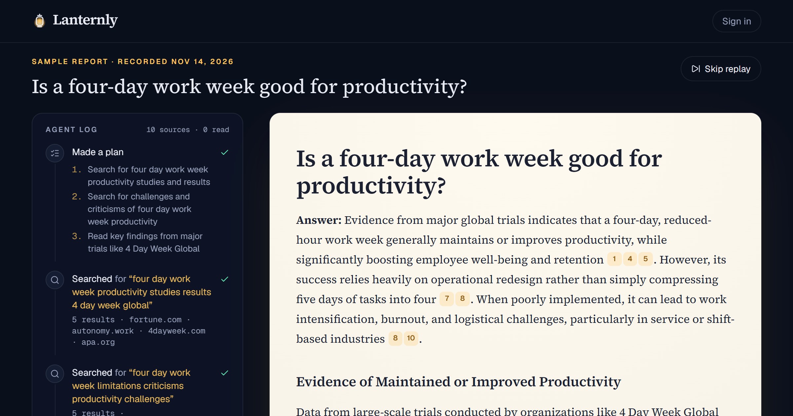
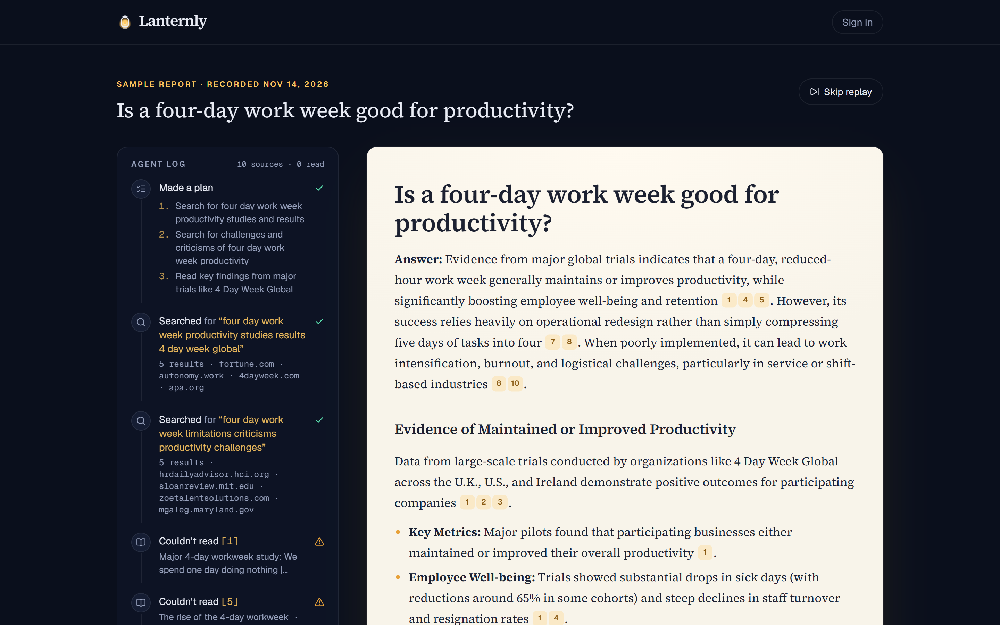
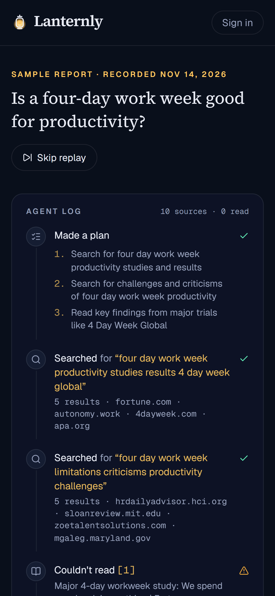

# Lanternly: case study

**Role:** Design and development (solo)
**Type:** AI agent web app
**Stack:** Next.js 16, TypeScript, Tailwind CSS v4, Vercel AI SDK 7, Gemini 3.5 Flash-Lite, Tavily, Jina Reader, Supabase, Vercel
**Links:** [Live site](https://lanternly-research-agent.vercel.app) · [Code](https://github.com/shervs336/lanternly-research-agent)

---

## Short version (for a portfolio card)

> An AI research agent that shows its work. It plans, searches the web, reads sources and streams a report where every claim links to its source, while a live log shows each step. It has sign-in, saved and shareable reports, exports, and rate limits that keep it running on free tiers.

---

## Problem

AI answers are fast but hard to trust: you can't see where a claim came from or what the model skipped. Research tools that do show sources often hide the process, so it's unclear whether the AI actually read anything.

The goal was an agent whose work is visible end to end, with every claim traceable, while running publicly at $0.

## Approach

- **Make the process the product.** Every tool call (plan, each search, each page read) streams to the browser as it happens and appears in an agent log beside the report.
- **Number the sources at the tool level.** The search tool assigns each result a stable number, and the report cites those numbers. The UI links each citation to its source and shows which sources were read, cited, or ignored.
- **Contrast for readability.** A dark "night" interface with the report on warm, lantern-lit paper keeps long text easy to read and makes the report the focus.

## Key decisions

| Decision | Why |
|---|---|
| Force `plan` first, remove tools for the last steps | Makes every run follow the same arc (plan → search → read → write) and guarantees a report. |
| `read` accepts only source numbers from search | Pages can contain prompt-injection text; the agent can never be steered into fetching an arbitrary URL. |
| Treat near-empty pages as failed reads | Paywalls and blocked pages return almost nothing; marking them failed stops the model from "citing" pages it didn't see. |
| Normalize `[2, 7]` citations | The model kept grouping citations despite instructions; fixing it in the parser too made every citation clickable. |
| Server-only database access | RLS with no public policies means the public key can't read anything; simpler and safer than per-table policies. |
| Daily limits (3 / 10 / 60) with hashed IPs | Keeps free Gemini and Tavily quotas from running out on a public demo. |
| Recorded sample replays | Visitors and reviewers can watch real runs without spending quota. |

## Testing

I tested the agent against real questions through both the API and the actual UI in a headless browser:
- Runs finished in **15–31 seconds**, with 10 sources found and 7–9 cited each.
- No grouped citations were left unconverted after the fix.
- The fourth anonymous run of the day is refused with a clear message, and short questions are rejected.
- Signed-out visitors to the library are redirected to sign-in and back.
- Mobile layout: no horizontal scroll, and the agent log stays readable mid-run.

One honest caveat: the free Flash-Lite model occasionally attributes a figure to a secondary source instead of the primary one. The source list makes that visible, which is the point of the design.

## Result

- Live, public AI agent running entirely on free tiers.
- **Lighthouse:** Desktop 100 / 100 / 100 / 100. Mobile Accessibility, Best Practices and SEO 100, Performance 77–82.

| Report | Mobile |
|---|---|
|  |  |

## What I'd do next

- **Claim checking:** a second pass where the agent verifies each cited claim against the page text and flags weak citations.
- **Follow-up questions** on a finished report, reusing its sources.
- **Deep mode:** parallel sub-agents for each plan step, merged into one report.
